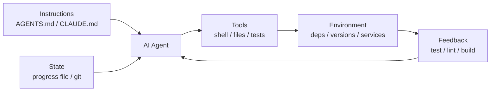

# Bài 02 – Harness thực sự là gì

> Bài gốc: [EN](../docs/en/lectures/lecture-02-what-a-harness-actually-is/index.md) · [VI](../docs/vi/lectures/lecture-02-what-a-harness-actually-is/index.md)
> Code ví dụ: `docs/en/lectures/lecture-02-what-a-harness-actually-is/code/` (`minimal-harness-loop.ts`, `harness-vs-no-harness.ts`)
> Project thực hành: **P01** (tiếp)
> Milestone DocVault: **M1: app shell + harness tối thiểu đủ 5 subsystem**

---

## 1. Ý chính trong 30 giây

Một prompt file **chưa phải** harness. Harness gồm **5 subsystem**: Instructions, Tools, Environment, State, Feedback. Thiếu một cái thì agent luôn "khó dùng". Trong 5 cái, **Feedback** (lệnh verify) thường là khoản đầu tư rẻ nhất mà lời nhiều nhất.

## 2. Mô hình 5 subsystem



| Subsystem | Câu hỏi nó trả lời | Artifact điển hình |
|---|---|---|
| **Instructions** | Dự án là gì, quy tắc nào bất khả xâm phạm? | `AGENTS.md`, `CLAUDE.md` |
| **Tools** | Agent được làm gì? | shell, file edit, test runner, MCP (theo least privilege) |
| **Environment** | Môi trường có tái tạo được không? | `package.json` lock, `.nvmrc`, devcontainer, Docker |
| **State** | Đang ở đâu, xong gì, kẹt gì? | `claude-progress.md`, git commits |
| **Feedback** | Làm đúng chưa? | `npm test`, `npm run check`, `npm run lint`, E2E |

## 3. Nguyên tắc quan trọng

- **Repo là single source of truth**: thứ agent không thấy thì coi như không tồn tại.
- **Give a map, not a manual**: `AGENTS.md` là "trang mục lục" khoảng 100 dòng, chi tiết để trong `docs/`.
- **Constrain, don't micromanage**: dùng rule chạy được (lint, test, script) thay vì liệt kê từng bước.
- **Tách người làm và người kiểm**: agent tự khen bài của mình, cần checker độc lập (bài 09, 13).
- **Ablation, bỏ từng cái một**: giữ model cố định, lần lượt bỏ từng subsystem, cái nào bỏ đi làm kết quả tụt nhiều nhất thì đang có giá trị nhất. Muốn tìm bottleneck thì vẫn phải dựa vào failure log, không chỉ ablation.
- **Gulf of Execution và Gulf of Evaluation**: agent "không biết làm thế nào" khác với agent "không biết mình làm đúng chưa". Hai vấn đề cần hai cách sửa khác nhau.

## 4. Ví dụ minh hoạ

Ví dụ trong bài (giả định để giảng): app React 20k dòng, thêm harness dần:

| Giai đoạn | Thêm gì | Success rate |
|---|---|---|
| 1 | Chỉ README | 20% |
| 2 | + AGENTS.md (stack, naming, kiến trúc) | 60% |
| 3 | + lệnh verify `yarn test && yarn lint && yarn build` | 80% |
| 4 | + progress file | 80–100% |

Model không đổi, chỉ harness thay đổi.

**Phần Feedback trong AGENTS.md** (bản cho DocVault):

```markdown
## Verification commands
- Typecheck: `npm run check`     # tsc cho cả tsconfig.json và tsconfig.node.json
- Unit test: `npm test`          # vitest run
- Lint:      `npm run lint`      # eslint src
- Full:      `npm run verify`    # check + lint + test, chạy trước khi báo xong
```

Tương đương .NET: `dotnet build -warnaserror && dotnet test && dotnet format --verify-no-changes`.

## 5. Áp dụng vào DocVault: M1

**Mục tiêu:** dựng app shell (giống 4 feature P01: window launch, document list, question panel, local data dir) **và** có đủ 5 subsystem.

| Subsystem | Việc cần làm trong DocVault |
|---|---|
| Instructions | `AGENTS.md` (overview, stack + version, lệnh chạy, ≤10 hard constraints, link docs). `CLAUDE.md` một dòng: "Đọc AGENTS.md trước". |
| Tools | Cho phép agent chạy `npm`, `git`, `npx tsx`. Chặn lệnh nguy hiểm (`rm -rf ~`, publish) bằng permission settings. |
| Environment | `.nvmrc` = `20`, `package-lock.json` commit vào git, script `npm run dev` (copy cách của `projects/shared/scripts/dev.js`). |
| State | `claude-progress.md` với 3 mục: Done / In progress / Blocked. |
| Feedback | `npm run verify` như trên + 1 test mẫu (`tests/unit/smoke.test.ts`). |

**Hard constraints khởi đầu cho DocVault:**

```markdown
## Hard constraints
1. Renderer KHÔNG import `fs`, `path`, `electron` trực tiếp, mọi I/O đi qua `window.api` (preload).
2. IPC channel chỉ khai báo trong `src/shared/types.ts` (IPC_CHANNELS).
3. API key (LLM/embedding) chỉ đọc ở main process, không bao giờ gửi xuống renderer.
4. Dữ liệu người dùng nằm trong `app.getPath('userData')/data`, không ghi vào thư mục source.
```

**Bài tập audit:** chấm điểm 1–5 cho từng subsystem của DocVault sau M1. Lấy subsystem điểm thấp nhất, dành 30 phút cải thiện.

## 6. Checklist tự kiểm tra

- [ ] Vẽ lại được sơ đồ 5 subsystem mà không nhìn tài liệu.
- [ ] DocVault có `npm run verify` chạy xanh.
- [ ] Đã đọc `projects/project-01/solution/AGENTS.md` và `CLAUDE.md`, so với bản của mình.
- [ ] Đã chạy `npx tsx docs/en/lectures/lecture-02-what-a-harness-actually-is/code/minimal-harness-loop.ts`.

## 7. Câu hỏi suy ngẫm

1. Với Cursor hay Claude Code bạn đang dùng, subsystem nào yếu nhất?
2. Một lỗi agent gần đây là Gulf of Execution hay Gulf of Evaluation?
