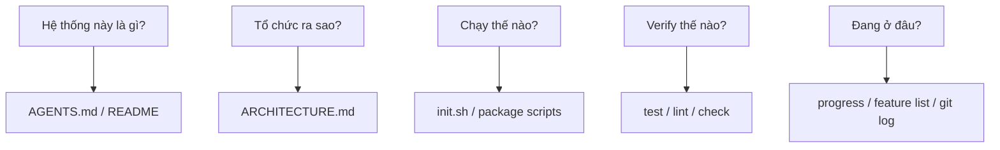

# Bài 03 – Repository là system of record

> Bài gốc: [EN](../docs/en/lectures/lecture-03-why-the-repository-must-become-the-system-of-record/index.md) · [VI](../docs/vi/lectures/lecture-03-why-the-repository-must-become-the-system-of-record/index.md)
> Code ví dụ: `.../lecture-03-.../code/` (`repo-reader.ts`, `repo-knowledge-layout.txt`, `system-of-record-checklist.md`)
> Project thực hành: **P02: Agent-readable workspace** (`projects/project-02/`)
> Milestone DocVault: **M2: PRODUCT.md, ARCHITECTURE.md, DECISIONS.md cho kiến trúc RAG**

---

## 1. Ý chính trong 30 giây

Agent chỉ có 3 nguồn input: system prompt/task, **file trong repo**, và output của tool. Quyết định nằm trong Confluence, Jira, Slack hay trong đầu senior thì **agent không thấy**. Vì vậy repo phải trở thành **system of record**: nơi có thẩm quyền cao nhất về kiến trúc, ràng buộc, tiến độ và tiêu chuẩn verify.

## 2. Khái niệm cốt lõi

| Khái niệm | Nghĩa |
|---|---|
| **Knowledge visibility gap** | Tỉ lệ tri thức dự án **không** nằm trong repo. Gap càng lớn, agent fail càng nhiều. |
| **Fresh session test** | Mở session mới, chỉ cho xem repo, rồi hỏi 5 câu (bên dưới). |
| **Discovery cost** | Lượng context agent tốn để tìm ra một thông tin quan trọng. |
| **Knowledge decay** | Docs lỗi thời còn nguy hiểm hơn không có docs. |
| **ACID cho agent state** | Atomicity, Consistency, Isolation, Durability áp vào cách agent commit thay đổi. |

**5 câu hỏi của fresh session test:**



## 3. Bốn nguyên tắc vẽ "bản đồ"

1. **Knowledge sống cạnh code**: rule về RAG để ở `src/services/rag/README.md`, không nhét vào một doc global khổng lồ.
2. **Entry file chuẩn hoá**: `AGENTS.md` 50–100 dòng trả lời "là gì / chạy sao / verify sao".
3. **Tối thiểu nhưng đủ**: rule nào bỏ đi mà không ảnh hưởng quyết định của agent thì không nên tồn tại.
4. **Cập nhật cùng code**: doc đặt trong thư mục module để khi sửa code thì thấy doc ngay.

## 4. ACID cho agent (liên hệ backend)

| ACID | Với agent | Thực hành |
|---|---|---|
| Atomicity | Một thay đổi logic (feature + test) commit trọn vẹn hoặc bỏ hẳn | 1 feature = 1 commit; fail thì `git restore` |
| Consistency | Sau mỗi thao tác, repo ở trạng thái verify được | `npm run verify` xanh trước khi commit |
| Isolation | Nhiều agent không giẫm chân nhau | Mỗi agent một branch/worktree, progress file riêng |
| Durability | Tri thức xuyên session phải nằm trong file được git track | DECISIONS.md, progress file |

Bạn đã quen transaction ở SQL Server/PostgreSQL. Ở đây ý tưởng giống hệt, chỉ khác "đơn vị dữ liệu" là trạng thái repo.

## 5. Ví dụ minh hoạ: ADR ngắn

```markdown
# DECISIONS.md

## 2026-11-20 – ADR-003: Dùng SQLite + sqlite-vec làm vector store
- Bối cảnh: app desktop, local-first, < 50k chunks, không muốn chạy server riêng.
- Quyết định: better-sqlite3 + extension sqlite-vec, 1 file `docvault.db`.
- Loại bỏ: LanceDB (thêm native binary lớn), Qdrant/pgvector (cần server).
- Hệ quả: embedding dimension cố định theo provider; đổi provider phải re-index.
- Hết hiệu lực khi: số chunk > 500k hoặc cần sync nhiều máy.
```

Một ADR 10 dòng nằm ngay trong repo có giá trị hơn một trang Confluence 20 trang mà agent không đọc được.

## 6. Áp dụng vào DocVault: M2

**Mục tiêu:** DocVault vượt qua fresh session test. Đồng thời làm phần product của P02: **document import, document detail, local persistence**.

Tạo các file:

```
docvault/
├── AGENTS.md
├── docs/
│   ├── PRODUCT.md        # user là ai, 5 user story chính, ngoài phạm vi (non-goals)
│   ├── ARCHITECTURE.md   # main / preload / renderer / services, luồng IPC, luồng RAG
│   └── DECISIONS.md      # ADR-001 Electron, ADR-002 JSON storage giai đoạn đầu, ADR-003 sqlite-vec
└── src/services/
    └── README.md         # trách nhiệm từng service, interface công khai
```

**Nội dung tối thiểu cho `ARCHITECTURE.md`:**

```markdown
## Process boundaries
- main:     window, IPC handlers, khởi tạo services, đọc secrets
- preload:  contextBridge → window.api (typed theo src/shared/types.ts)
- renderer: React UI, không I/O trực tiếp
- services: DocumentService, PersistenceService, IndexingService, QaService (chỉ chạy ở main)

## Data flow: import
renderer (ImportPanel) → window.api.importDocument(path)
  → IPC 'document:import' → DocumentService.import() → PersistenceService.save()
  → trả DocumentMeta về renderer
```

**Chạy fresh session test:** mở Claude Code session mới trong `docvault/`, gõ đúng 5 câu hỏi. Câu nào agent trả lời sai hoặc phải đoán thì bổ sung vào repo. Lặp lại đến khi đúng hết 5 câu.

**Tham chiếu:** so `projects/project-02/starter/docs/` (mỏng) với `projects/project-02/solution/docs/` (đầy đủ) để thấy độ chi tiết vừa đủ.

## 7. Checklist tự kiểm tra

- [ ] DocVault trả lời đúng 5 câu fresh session test.
- [ ] Đã liệt kê ≥10 quyết định/ràng buộc của dự án và đánh dấu cái nào nằm trong repo; gap < 10%.
- [ ] Có ít nhất 3 ADR trong `DECISIONS.md`, mỗi ADR có mục "Loại bỏ" và "Hết hiệu lực khi".
- [ ] Đã chạy `npx tsx docs/en/lectures/lecture-03-why-the-repository-must-become-the-system-of-record/code/repo-reader.ts`.

## 8. Câu hỏi suy ngẫm

1. Ở công ty, rule "mọi endpoint phải qua OAuth" đang nằm ở đâu? Agent có tìm thấy không?
2. Doc nào trong repo của bạn đã lỗi thời và có thể dẫn agent đi sai hướng?
