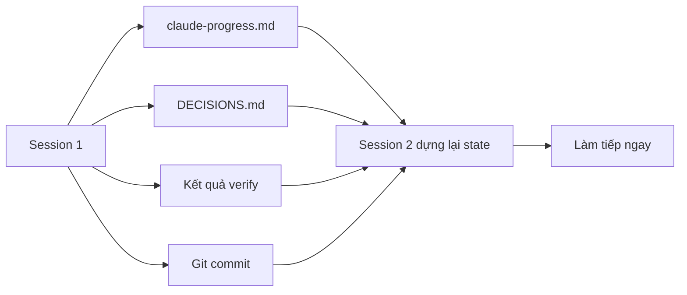

# Bài 05 – Giữ context sống qua nhiều session

> Bài gốc: [EN](../docs/en/lectures/lecture-05-why-long-running-tasks-lose-continuity/index.md) · [VI](../docs/vi/lectures/lecture-05-why-long-running-tasks-lose-continuity/index.md)
> Code ví dụ: `.../lecture-05-.../code/` (`session-simulator.ts`, `session-handoff.md`, `continuity-checklist.md`)
> Project thực hành: **P03: Multi-session continuity** (`projects/project-03/`)
> Milestone DocVault: **M4: progress + decision log + handoff; làm import/persistence qua 2 session**

---

## 1. Ý chính trong 30 giây

Context window luôn hữu hạn. Task dài chắc chắn sẽ vượt qua nhiều session. Khi session kết thúc, agent mất phần **"why"** (vì sao chọn A thay vì B) và chỉ còn lại phần **"what"** (code). Cách xử lý: **coi agent như một kỹ sư bị xoá trí nhớ ngắn hạn mỗi ca làm**. Trước khi "tan ca", agent phải ghi lại: đã làm gì, vì sao, tiếp theo là gì.

## 2. Khái niệm cốt lõi

| Khái niệm | Nghĩa |
|---|---|
| **State persistence files** | File cho phép session mới tiếp tục không mơ hồ: progress, decisions, verify results, next steps |
| **Rebuild cost** | Thời gian để session mới đến được trạng thái làm việc được (mục tiêu < 3 phút) |
| **Drift** | Độ lệch giữa hiểu biết của agent và trạng thái thật của repo; cộng dồn qua mỗi session |
| **Context anxiety** | Gần hết context thì agent vội kết thúc, bỏ verify |
| **Compaction vs. reset** | Compaction: tóm tắt trong cùng session (giữ "what", dễ mất "why"). Reset: session mới, dựng lại từ artifacts (sạch, nhưng phụ thuộc chất lượng handoff) |



**Chiến lược hỗn hợp:** task ngắn (< 30 phút) làm trong 1 session. Task dài thì dùng progress + decisions. Khi đã dùng khoảng 60% window thì bắt đầu chuẩn bị handoff.

> Lưu ý từ bài gốc: mức độ context anxiety **khác nhau theo model** (Sonnet 4.5 nặng hơn Opus 4.5). Harness phải hiểu model mục tiêu, không có template dùng chung cho mọi model.

## 3. Ví dụ minh hoạ: bộ 4 công cụ

**① `claude-progress.md`:**

```markdown
# Progress

## Current state
- Last commit: 9f3c2ab (feat: persist document index to data/index.json)
- `npm run verify`: 18/19 pass (persistence.test.ts › "survives restart" FAIL)

## Done
- [x] F03 Document import (.md/.txt, ≤10MB)
- [x] F04 Document detail view

## In progress
- [ ] F05 Persistence across restart: ghi được nhưng load lúc startup chưa gọi

## Known issues
- PersistenceService.load() chưa được gọi trong main.ts `app.whenReady()`

## Next steps
1. Gọi load() trước khi register IPC handlers
2. Chạy lại test "survives restart"
```

**② `DECISIONS.md`:** dạng ADR ngắn (xem bài 03).

**③ Git commit = checkpoint:** commit message giải thích *what + why*.

**④ Routine "chấm công" trong AGENTS.md:**

```markdown
## Session start (clock in)
1. Đọc claude-progress.md và session-handoff.md
2. Đọc DECISIONS.md nếu task đụng kiến trúc
3. Chạy `npm run verify`; nếu đỏ thì sửa trước khi làm feature mới
4. Bắt đầu từ mục "Next steps"

## Session end (clock out)
1. Cập nhật claude-progress.md (state, done, in progress, issues, next)
2. Chạy `npm run verify`
3. Commit mọi thay đổi đã hoàn thành
```

## 4. Áp dụng vào DocVault: M4

**Mục tiêu:** hoàn thành 3 feature của P02/P03 (import, detail, persistence) **cố ý chia thành 2 session** để thử continuity.

1. Session 1: làm import + detail, dừng giữa chừng phần persistence, chạy routine clock-out.
2. Đóng hẳn session. Mở session mới và **không giải thích gì**, chỉ nói "Continue".
3. Đo: mất bao lâu agent mới bắt đầu code có ích? Agent có quyết định trái ngược với session 1 không (ví dụ đổi format lưu JSON)?
4. Lặp lại một lần không có progress file để so sánh rebuild cost.

**`session-handoff.md`** (template 4 trường, tham khảo `docs/en/resources/templates/session-handoff.md`):

```markdown
# Session handoff – 2026-11-22 21:30
- Repo state: branch main @ 9f3c2ab, working tree clean
- Runtime state: verify 18/19, app launch OK, import 2 file mẫu OK
- Blockers: chưa rõ có cần migrate format index.json v0 không (xem DECISIONS ADR-005)
- Next action: F05: gọi PersistenceService.load() trong main.ts, chạy test "survives restart"
```

**Liên hệ với RAG sau này:** quyết định như "chunk size 500", "embedding model X dimension 1024" **bắt buộc** phải vào DECISIONS.md. Nếu session sau đổi model embedding mà không re-index thì vector search sẽ sai âm thầm, đây là loại bug rất khó tìm.

## 5. Checklist tự kiểm tra

- [ ] DocVault có `claude-progress.md`, `DECISIONS.md`, `session-handoff.md`.
- [ ] AGENTS.md có routine clock-in / clock-out.
- [ ] Đã đo rebuild cost có và không có progress file.
- [ ] Đã chạy `npx tsx docs/en/lectures/lecture-05-why-long-running-tasks-lose-continuity/code/session-simulator.ts`.
- [ ] Đã so `projects/project-03/starter` với `solution` (`session-handoff.md`, `claude-progress.md`).

## 6. Câu hỏi suy ngẫm

1. Khi dùng Claude Code, bạn hay để auto-compaction hay chủ động mở session mới? Mỗi cách mất gì?
2. Thông tin nào trong progress file hiện tại sẽ khiến session sau hiểu sai?
