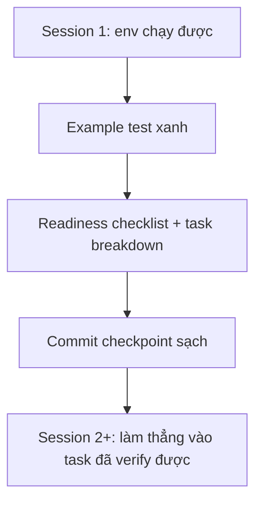

# Bài 06 – Initialization là một phase riêng

> Bài gốc: [EN](../docs/en/lectures/lecture-06-why-initialization-needs-its-own-phase/index.md) · [VI](../docs/vi/lectures/lecture-06-why-initialization-needs-its-own-phase/index.md)
> Code ví dụ: `.../lecture-06-.../code/` (`init.sh`, `init-check.ts`, `initializer-output-checklist.md`)
> Project thực hành: **P03** (tiếp)
> Milestone DocVault: **M5: `init.sh`, example test xanh, task breakdown cho phần RAG**

---

## 1. Ý chính trong 30 giây

Đừng để agent vừa dựng hạ tầng vừa code feature. Hai việc này có **mục tiêu tối ưu khác nhau**. Implementation tối ưu số feature đã verify. Initialization tối ưu độ tin cậy cho **mọi session sau**. Trộn lẫn thì agent ưu tiên code (thấy kết quả ngay) và bỏ bê hạ tầng. Session đầu tiên chỉ nên làm initialization.

## 2. Khái niệm cốt lõi

| Khái niệm | Nghĩa |
|---|---|
| **Initialization phase** | Phase đầu, chỉ tạo tiền đề: môi trường, test framework, docs, task list. Không code business. |
| **Startup readiness** | 4 điều kiện: **can start, can test, can see progress, can pick up next step** |
| **From template > from scratch** | Bắt đầu từ template có sẵn (ở đây là `projects/shared/`) |
| **Always ready to hand off** | Bất kỳ lúc nào, một agent mới cũng tiếp quản được chỉ bằng cách đọc repo |
| **Time to first passing test** | Metric đo hiệu quả initialization |
| **Implicit assumption landmine** | Session 1 chọn Vitest, session 2 không biết nên thêm Jest. Hai framework cùng tồn tại. |



## 3. Ví dụ minh hoạ: `init.sh` cho DocVault

```bash
#!/usr/bin/env bash
# init.sh: idempotent, chạy bao nhiêu lần cũng được
set -euo pipefail

echo "==> Checking Node version"
required="$(cat .nvmrc)"
current="$(node -v | sed 's/v//' | cut -d. -f1)"
if [ "$current" != "$required" ]; then
  echo "FAIL: Node $required required, found $current. Run: nvm use" >&2
  exit 1
fi

echo "==> Installing dependencies"
npm ci

echo "==> Typecheck"
npm run check

echo "==> Unit tests"
npm test

echo "==> Checking .env"
if [ ! -f .env ]; then
  cp .env.example .env
  echo "NOTE: created .env from .env.example. Set ANTHROPIC_API_KEY for real Q&A (mock is used otherwise)."
fi

echo "OK: environment ready. Next: read claude-progress.md"
```

Để ý thông báo lỗi có **cách sửa** ("Run: nvm use"). Đây là agent-oriented error message, sẽ học kỹ ở bài 09–10.

**Task breakdown (phần RAG của DocVault):**

```markdown
# Task breakdown

## T1 Chunking
- Cắt document thành chunk ~500 ký tự theo paragraph, overlap 50
- Acceptance: `npx vitest run tests/unit/chunker.test.ts` pass (5 case: rỗng, 1 đoạn, nhiều đoạn, đoạn > 500, unicode tiếng Việt)

## T2 Metadata extraction
- Title (H1 hoặc tên file), word count, language
- Acceptance: tests/unit/metadata.test.ts pass

## T3 Embedding provider interface + FakeEmbeddingProvider
- Acceptance: tests/unit/embedding.test.ts pass, vector dimension đúng config

## T4 Vector store (sqlite-vec)
- Acceptance: tests/integration/vector-store.test.ts: insert 100 vector, top-5 đúng thứ tự cosine
```

## 4. Áp dụng vào DocVault: M5

**Mục tiêu:** chạy một **session chỉ để initialization** cho giai đoạn RAG, rồi mới code ở bài 07–08.

Trong session đó, agent phải tạo:

1. `init.sh` (như trên) và `.env.example` (`ANTHROPIC_API_KEY=`, `EMBEDDING_PROVIDER=fake`).
2. Thư mục `tests/unit`, `tests/integration`, `tests/fixtures/` với 3 file tài liệu mẫu (1 tiếng Anh, 1 tiếng Việt, 1 file dài > 5k ký tự).
3. Một **example test** cho mỗi tầng: `tests/unit/smoke.test.ts`, `tests/integration/db-smoke.test.ts` (mở SQLite in-memory, load sqlite-vec).
4. Task breakdown T1–T4 như trên.
5. Cập nhật `claude-progress.md` và commit `chore: initialize RAG phase`.

**Initialization acceptance checklist:**

```markdown
- [ ] `./init.sh` thành công trên máy sạch (thử: xoá node_modules rồi chạy lại)
- [ ] Mỗi tầng test có ≥1 test xanh
- [ ] Session mới trả lời được "chạy sao / test sao" chỉ bằng repo
- [ ] Task breakdown có ≥3 task, mỗi task có acceptance là một lệnh
- [ ] Đã commit
```

**.NET tương đương:** `init.ps1`/`init.sh` với `dotnet --version` check theo `global.json`, `dotnet restore`, `dotnet build`, `dotnet test --filter Category=Smoke`.

## 5. Checklist tự kiểm tra

- [ ] Phân biệt được initialization và implementation, và giải thích vì sao trộn lẫn hai cái thì cả hai đều tệ.
- [ ] `init.sh` của DocVault idempotent (chạy 2 lần liên tiếp không lỗi).
- [ ] Đã chạy `npx tsx docs/en/lectures/lecture-06-why-initialization-needs-its-own-phase/code/init-check.ts`.
- [ ] Đã đọc `projects/project-03/solution/init.sh`.

## 6. Câu hỏi suy ngẫm

1. Ở dự án thật, "time to first passing test" cho một dev mới là bao lâu? Cho agent thì sao?
2. Template nội bộ nào của công ty có thể dùng làm điểm khởi đầu cho agent?
