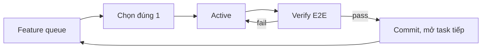

# Bài 07 – Vẽ ranh giới task rõ ràng (WIP=1)

> Bài gốc: [EN](../docs/en/lectures/lecture-07-why-agents-overreach-and-under-finish/index.md) · [VI](../docs/vi/lectures/lecture-07-why-agents-overreach-and-under-finish/index.md)
> Code ví dụ: `.../lecture-07-.../code/` (`scope-tracker.ts`, `scope-surface-example.md`, `next-task-template.md`)
> Project thực hành: **P04: Runtime feedback & scope control** (`projects/project-04/`)
> Milestone DocVault: **M6: Chunking + metadata, đúng một feature mỗi lần**

---

## 1. Ý chính trong 30 giây

Agent có xu hướng "tiện tay làm thêm": đang làm đăng ký user thì refactor luôn error middleware, sắp xếp lại thư mục test... Kết quả là 6 việc dở dang và không việc nào chạy end-to-end. Đây là **overreach** dẫn đến **under-finish**. Cách sửa: **WIP=1**. Chỉ một task ở trạng thái active, xong và verify được mới mở task tiếp theo.

## 2. Khái niệm cốt lõi

| Khái niệm | Nghĩa |
|---|---|
| **Overreach** | Kích hoạt nhiều task hơn mức tối ưu trong một session |
| **Under-finish** | Tỉ lệ task pass E2E trên số task đã kích hoạt thấp hơn ngưỡng |
| **WIP limit** | Từ Kanban: giới hạn số việc đang dở. Với agent, WIP=1 là mặc định an toàn |
| **Completion evidence** | Điều kiện verify được để chuyển "in progress" sang "done" |
| **Scope surface** | DAG các work unit với 4 trạng thái: `not_started`, `active`, `blocked`, `passing` |
| **Completion pressure** | Áp lực harness tạo ra để agent phải hoàn thành task hiện tại |
| **VCR (Verified Completion Rate)** | số task verified / số task đã kích hoạt; VCR < 1 thì không mở task mới |

**Toán học đơn giản:** context C chia cho k task thì mỗi task được C/k. Khi C/k thấp hơn ngưỡng tối thiểu thì không task nào xong. Little's Law: L = λ·W, WIP (L) cao thì lead time (W) của mỗi task tăng.



## 3. Ví dụ minh hoạ

Bài gốc (giả định để giảng): REST API 8 feature.

| | Không ràng buộc | WIP=1 |
|---|---|---|
| Session 1 | 5 feature, 12 file, 800 dòng, 20% pass | 1 feature, 4 file, 200 dòng, 100% pass |
| Kết quả cuối | 3/8 xong (37.5%) | 7/8 xong (87.5%) |

**Rule cho AGENTS.md:**

```markdown
## Work rules
- Mỗi lần chỉ làm MỘT feature (feature đang `active` trong feature_list.json)
- Chỉ mở feature tiếp theo khi feature hiện tại đã `passing`
- KHÔNG "tiện thể refactor" code ngoài phạm vi feature
- Thấy vấn đề ngoài phạm vi: ghi vào claude-progress.md › "Discovered issues", không sửa
```

Mục "Discovered issues" rất quan trọng. Nó cho agent một **lối thoát hợp lệ** cho ý muốn làm thêm, thay vì cấm suông.

## 4. Áp dụng vào DocVault: M6

**Mục tiêu:** làm T1 Chunking và T2 Metadata (từ bài 06) **lần lượt**, mỗi cái một session, có completion evidence.

**Scope surface dạng Markdown (`docs/scope.md`, hoặc để JSON ở bài 08):**

```markdown
| ID | Work unit | Phụ thuộc | Trạng thái | Evidence |
|---|---|---|---|---|
| T1 | Chunker theo paragraph | – | active | – |
| T2 | Metadata extraction | – | not_started | – |
| T3 | EmbeddingProvider + Fake | T1 | not_started | – |
| T4 | Vector store sqlite-vec | T3 | not_started | – |
| T5 | Indexing status UI | T1,T2 | not_started | – |
```

**Prompt cho session T1 (dùng `next-task-template.md` của bài):**

```
Task: T1 Chunker.
Behavior: IndexingService.chunk(doc) trả về Chunk[] ~500 ký tự, cắt tại paragraph,
overlap 50, mỗi chunk có {docId, index, text, charStart, charEnd}.
Completion evidence: `npx vitest run tests/unit/chunker.test.ts` pass (5 case),
và `npm run verify` xanh.
Out of scope: embedding, UI, đổi format lưu trữ.
Nếu thấy vấn đề khác, ghi vào Discovered issues.
```

**Bẫy thường gặp với RAG:** agent làm chunker xong sẽ rất muốn "tiện thể" gọi embedding API luôn. Hãy chặn lại. Embedding là T3 và cần interface + fake provider trước.

**Tham chiếu:** `projects/project-04/starter` có một bug chunking file lớn được cài sẵn. Thử để agent sửa bug đó với WIP=1 (chỉ sửa bug, không refactor).

## 5. Checklist tự kiểm tra

- [ ] AGENTS.md có Work rules WIP=1 và mục Discovered issues.
- [ ] T1 và T2 mỗi cái có evidence (lệnh test + commit hash).
- [ ] Đã đếm VCR của một session không ràng buộc so với một session WIP=1.
- [ ] Đã chạy `npx tsx docs/en/lectures/lecture-07-why-agents-overreach-and-under-finish/code/scope-tracker.ts`.

## 6. Câu hỏi suy ngẫm

1. Trong sprint thật của team, WIP trung bình mỗi dev là bao nhiêu? Có ảnh hưởng lead time không?
2. Hãy tách "Implement RAG" thành ≥5 work unit, mỗi unit có một hành vi + một lệnh verify + phụ thuộc.
