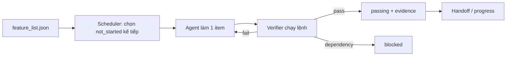

# Bài 08 – Feature list là harness primitive

> Bài gốc: [EN](../docs/en/lectures/lecture-08-why-feature-lists-are-harness-primitives/index.md) · [VI](../docs/vi/lectures/lecture-08-why-feature-lists-are-harness-primitives/index.md)
> Code ví dụ: `.../lecture-08-.../code/` (`feature_list.json`, `feature-list-validator.ts`, `pass-gate-policy.md`)
> Project thực hành: **P04** (tiếp)
> Milestone DocVault: **M7: `feature_list.json` + script verifier; embedding + vector store**

---

## 1. Ý chính trong 30 giây

Feature list **không phải** memo cho người đọc. Nó là **cấu trúc dữ liệu nền** mà các thành phần khác của harness dựa vào: scheduler chọn task, verifier quyết định "xong", handoff reporter sinh tóm tắt. Mỗi feature phải có bộ ba **(behavior, verification command, state)**, và **harness**, không phải agent, là bên chuyển state sang `passing`.

## 2. Khái niệm cốt lõi

| Khái niệm | Nghĩa |
|---|---|
| **Harness primitive** | Cấu trúc nền mà mọi component khác đọc |
| **Triple** | `behavior` (làm gì), `verification` (thế nào là xong), `state` (đang ở đâu) |
| **State machine** | `not_started → active → passing`, hoặc sang `blocked` |
| **Pass-state gating** | Chỉ khi verification command chạy thành công thì mới được sang `passing` |
| **Single source of truth** | Mọi "việc cần làm" đều suy ra từ một file duy nhất |
| **Back-pressure** | Số feature chưa pass là áp lực harness đặt lên agent; về 0 nghĩa là xong dự án |

**So sánh với database:** feature list giống **constraint/trigger ở tầng DB** (không câu SQL nào vượt qua được), không phải validation ở tầng app (dễ bị bypass).



## 3. Ví dụ minh hoạ

**Memo (tồi):** `Did import, chunking mostly done, embedding chưa`. "Mostly done" nghĩa là gì? Session mới không trả lời được.

**Feature item (tốt):**

```json
{
  "id": "F08",
  "name": "Embedding provider",
  "behavior": "EmbeddingProvider.embed(texts[]) trả về number[][] với dimension = config.embedding.dim; FakeEmbeddingProvider deterministic theo hash nội dung",
  "verification": "npx vitest run tests/unit/embedding.test.ts",
  "dependsOn": ["F06"],
  "state": "not_started",
  "evidence": null,
  "testedAt": null
}
```

**Granularity đúng:** "User có thể hỏi và nhận câu trả lời có citation" là vừa. "Làm RAG" là quá rộng. "Thêm field `dim` vào config" là quá hẹp. Tiêu chí: **hoàn thành được trong một session**.

## 4. Áp dụng vào DocVault: M7

**① `feature_list.json` cho giai đoạn RAG** (nối tiếp F01–F05 từ trước):

| ID | Feature | Verification |
|---|---|---|
| F06 | Chunker | `npx vitest run tests/unit/chunker.test.ts` |
| F07 | Metadata extraction | `npx vitest run tests/unit/metadata.test.ts` |
| F08 | Embedding provider (+Fake, +Voyage/OpenAI) | `npx vitest run tests/unit/embedding.test.ts` |
| F09 | Vector store sqlite-vec | `npx vitest run tests/integration/vector-store.test.ts` |
| F10 | Index pipeline (chunk → embed → store) + status UI | `npx vitest run tests/integration/index-pipeline.test.ts` |
| F11 | Retrieval top-k | `npx vitest run tests/integration/retrieval.test.ts` |
| F12 | Q&A có citation | (bài 09–10: thêm E2E) |

**② Script verifier**: agent **không được** tự sửa `state`.

```ts
// scripts/verify-feature.ts — usage: npx tsx scripts/verify-feature.ts F08
import { readFileSync, writeFileSync } from "node:fs";
import { execSync } from "node:child_process";

const id = process.argv[2];
const path = "feature_list.json";
const list = JSON.parse(readFileSync(path, "utf8"));
const f = list.features.find((x: any) => x.id === id);
if (!f) throw new Error(`Feature ${id} not found`);

const blockers = (f.dependsOn ?? []).filter(
  (d: string) => list.features.find((x: any) => x.id === d)?.state !== "passing",
);
if (blockers.length) {
  f.state = "blocked";
  console.error(`BLOCKED: ${id} depends on ${blockers.join(", ")}. Finish those first.`);
} else {
  try {
    const out = execSync(f.verification, { encoding: "utf8", stdio: "pipe" });
    f.state = "passing";
    f.evidence = out.split("\n").filter((l) => /passed|Tests/.test(l)).join(" | ");
    f.testedAt = new Date().toISOString();
    console.log(`PASS: ${id}`);
  } catch (e: any) {
    f.state = "active";
    console.error(`FAIL: ${id}\n${e.stdout ?? ""}\nFIX: make '${f.verification}' pass; do not edit feature_list.json by hand.`);
    process.exitCode = 1;
  }
}
writeFileSync(path, JSON.stringify(list, null, 2) + "\n");
```

**③ Rule trong AGENTS.md:**

```markdown
## Feature list rules
- Nguồn sự thật duy nhất: feature_list.json
- Chỉ 1 feature `active`
- KHÔNG sửa `state`/`evidence` bằng tay, chỉ chạy `npx tsx scripts/verify-feature.ts <ID>`
```

**④ Thiết kế cho RAG:** F08 cần interface để test không gọi mạng:

```ts
export interface EmbeddingProvider {
  readonly model: string;
  readonly dim: number;
  embed(texts: string[]): Promise<number[][]>;
}
```

Lưu `model` + `dim` vào bảng `index_meta` của SQLite. Khi khởi động, nếu không khớp config thì báo lỗi "re-index required" (gắn với ADR ở bài 03).

**Tương đương .NET:** `feature_list.json` giữ nguyên; verification là `dotnet test --filter FullyQualifiedName~EmbeddingTests`; verifier có thể viết bằng một console app nhỏ hoặc PowerShell.

## 5. Checklist tự kiểm tra

- [ ] Mọi feature trong DocVault có đủ triple + `dependsOn`.
- [ ] Có `scripts/verify-feature.ts`, và rule cấm sửa state bằng tay.
- [ ] Đã chạy `npx tsx docs/en/lectures/lecture-08-why-feature-lists-are-harness-primitives/code/feature-list-validator.ts`.
- [ ] Đã so `projects/project-04/solution/feature_list.json` với của mình.

## 6. Câu hỏi suy ngẫm

1. Có TODO trong code hay yêu cầu ngầm trong chat nào mâu thuẫn với feature list không?
2. Với F12 (Q&A), một lệnh verify "lỏng" và một lệnh verify "chặt" khác nhau thế nào?
