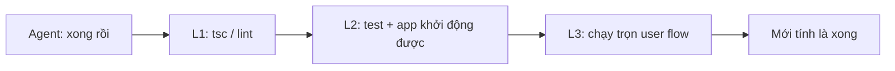

# Bài 09 – Ngăn agent tuyên bố chiến thắng quá sớm

> Bài gốc: [EN](../docs/en/lectures/lecture-09-why-agents-declare-victory-too-early/index.md) · [VI](../docs/vi/lectures/lecture-09-why-agents-declare-victory-too-early/index.md)
> Code ví dụ: `.../lecture-09-.../code/` (`victory-detector.ts`, `clean-state-checklist.md`)
> Project thực hành: **P05: Grounded Q&A verification** (`projects/project-05/`)
> Milestone DocVault: **M8: Grounded Q&A có citation + 3 lớp termination check + evaluator riêng**

---

## 1. Ý chính trong 30 giây

Model neural **tự tin quá mức một cách có hệ thống** (Guo et al., 2017). Agent "cảm thấy xong": unit test xanh nên báo done. Nhưng app chưa từng khởi động, migration hỏng giữa chừng, config thiếu. Harness phải **thay "cảm giác" của agent bằng verification chạy thật, đặt bên ngoài agent**, và **tách người làm (generator) khỏi người kiểm (evaluator)**.

## 2. Khái niệm cốt lõi

| Khái niệm | Nghĩa |
|---|---|
| **Premature completion declaration** | Agent nói xong trong khi spec chưa đạt |
| **Confidence calibration bias** | Độ tự tin tự báo cao hơn chất lượng thật, nặng hơn ở task nhiều file |
| **Termination criteria** | Bộ điều kiện chạy được, đạt hết mới được nói "xong" |
| **Verification–Validation dual gate** | Verify: code đúng spec. Validate: hệ thống đúng yêu cầu E2E |
| **Runtime feedback signals** | Log, process state, health check, là căn cứ khách quan |
| **Completion priority** | Đúng chức năng trước, rồi đến performance, cuối cùng mới là style. Không refactor khi core chưa verify |

**3 lớp termination check:**



**Self-evaluation bias:** cùng một model vừa tạo vừa chấm thì sẽ chấm rộng tay. Giải pháp không phải bảo nó "khách quan hơn" mà là **dùng một evaluator độc lập, được tune để khó tính**. Trong P05, rubric cho thấy single-role được 1.6/5, gen-eval 3.3/5, plan-gen-eval 4.9/5.

## 3. Ví dụ minh hoạ: thông báo lỗi dành cho agent

Tồi:

```
Test failed
```

Tốt (có **what, why, fix**):

```
FAIL qa.e2e: answer has 0 citations for question "Chunk size mặc định là bao nhiêu?"
WHY: QaService must return >=1 citation pointing to a retrieved chunk (docs/rag-pipeline.md#citations)
FIX: check RetrievalService.topK() returns chunks (log line 'retrieval.done' shows k=0?);
     ensure prompt-builder includes chunk ids as [doc:chunk] markers and parser extracts them.
```

## 4. Áp dụng vào DocVault: M8 (F12: Grounded Q&A)

**Behavior:** `QaService.ask(question)` thực hiện retrieve top-k, build prompt, gọi `LlmProvider`, rồi parse ra `{answer, citations: [{docId, chunkIndex, quote}]}`. Nếu không đủ bằng chứng thì trả `"Không tìm thấy trong kho tài liệu"`, **không được bịa**.

**Prompt template (trong `src/services/rag/prompt-builder.ts`):**

```
Bạn chỉ được trả lời dựa trên CONTEXT. Mỗi câu khẳng định phải kèm marker [docId:chunkIndex].
Nếu CONTEXT không đủ, trả lời đúng: "NOT_FOUND".
CONTEXT:
[a1b2:0] ...
[a1b2:1] ...
QUESTION: ...
```

**Definition of Done 3 lớp cho F12 (đặt trong AGENTS.md/feature_list):**

```markdown
- L1: `npm run check && npm run lint`
- L2: `npx vitest run tests/integration/qa.test.ts` (MockLlmProvider trả lời có marker)
      + app khởi động không lỗi (`npm run smoke`: main process ready trong 10s)
- L3: E2E (bài 10): import fixture → index → hỏi → UI hiện ≥1 citation và click mở đúng doc
- Grounding check: mọi citation phải trỏ tới chunk có trong kết quả retrieve
- Không qua L1 thì không chạy L2, không qua L2 thì không chạy L3
```

**Grounding check tự động (một phần của verify):**

```ts
export function assertGrounded(res: QaResult, retrieved: Chunk[]) {
  const ids = new Set(retrieved.map((c) => `${c.docId}:${c.index}`));
  const bad = res.citations.filter((c) => !ids.has(`${c.docId}:${c.chunkIndex}`));
  if (res.answer !== "NOT_FOUND" && res.citations.length === 0)
    throw new Error("UNGROUNDED: answer without citations. FIX: enforce markers in prompt-builder");
  if (bad.length)
    throw new Error(`HALLUCINATED_CITATION: ${JSON.stringify(bad)}. FIX: parser must drop ids not in retrieved set`);
}
```

**Tách generator/evaluator (giống P05):**

1. Session A (generator) làm F12.
2. Session B (evaluator) mở **mới hoàn toàn**, chỉ đọc diff + chạy app, chấm theo `evaluator-rubric.md` (correctness, groundedness, error handling, architecture). Bắt buộc phải nêu bằng chứng cụ thể cho mỗi điểm trừ.
3. Generator sửa theo feedback, rồi chấm lại.

**Tham chiếu:** `projects/project-05/solution/single-role/`, `gen-eval/`, `plan-gen-eval/`. Đọc `evaluator-rubric.md` của từng biến thể.

## 5. Checklist tự kiểm tra

- [ ] F12 có DoD 3 lớp + grounding check.
- [ ] Mọi thông báo lỗi trong scripts verify có `WHY` và `FIX`.
- [ ] Đã chạy một vòng generator và evaluator tách session, ghi điểm rubric.
- [ ] Đã chạy `npx tsx docs/en/lectures/lecture-09-why-agents-declare-victory-too-early/code/victory-detector.ts`.

## 6. Câu hỏi suy ngẫm

1. Unit test với mock `LlmProvider` bỏ sót loại lỗi nào của RAG thật (prompt quá dài, model không trả marker...)?
2. Vì sao "hãy tự review kỹ trước khi báo xong" không giải quyết được calibration bias?
