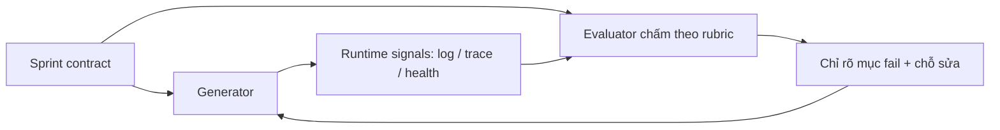

# Bài 11 – Làm runtime của agent quan sát được

> Bài gốc: [EN](../docs/en/lectures/lecture-11-why-observability-belongs-inside-the-harness/index.md) · [VI](../docs/vi/lectures/lecture-11-why-observability-belongs-inside-the-harness/index.md)
> Code ví dụ: `.../lecture-11-.../code/` (`runtime-logger.ts`, `sprint-contract.md`, `evaluator-rubric.md`)
> Project thực hành: **P06: Complete harness capstone** (`projects/project-06/`)
> Milestone DocVault: **M10: structured log + OpenTelemetry trace cho RAG, sprint contract, rubric**

---

## 1. Ý chính trong 30 giây

Không có observability thì agent quyết định trong mù mờ, đánh giá thành cảm tính, và retry thành mò mẫm. Observability có **hai lớp**: **runtime** (log, trace, health check: *hệ thống đã làm gì*) và **process** (sprint contract, rubric, acceptance criteria: *vì sao thay đổi này đáng được chấp nhận*). Nó phải được **thiết kế vào harness từ đầu**, không phải để agent tự in log.

## 2. Khái niệm cốt lõi

| Khái niệm | Nghĩa |
|---|---|
| **Runtime observability** | Log, trace, process event, health check |
| **Process observability** | Plan, sprint contract, rubric, acceptance criteria |
| **Task trace** | Bản ghi đường quyết định từ đầu đến cuối task, giống distributed tracing |
| **Sprint contract** | Thoả thuận trước khi code: scope, tiêu chuẩn verify, exclusions |
| **Evaluator rubric** | Chấm điểm có cấu trúc, có bằng chứng, để nhiều evaluator ra kết quả gần nhau |
| **Layered observability** | Runtime giải thích hành vi, process giải thích ý định |

**Vì sao agent không tự giải quyết được:** agent không biết mình thiếu gì, format log mỗi session một kiểu, và process observability là artifact có cấu trúc chứ không phải `console.log`.



Đây là phần bạn mạnh nhất (OpenTelemetry, Serilog, Dynatrace). Điểm mới ở đây là **người đọc log là agent**, nên log phải có cấu trúc, ổn định, và dẫn tới hành động.

## 3. Ví dụ minh hoạ

**Sprint contract (`docs/sprint-contracts/F13-rerank.md`):**

```markdown
# Sprint contract: F13 Rerank kết quả retrieval

## Scope
- Thêm bước rerank sau retrieve top-20 → giữ top-5
- Sửa RetrievalService, thêm RerankProvider interface + FakeReranker

## Verification
- tests/integration/retrieval.test.ts: fixture có câu hỏi mà top-1 trước rerank sai, sau rerank đúng
- npm run e2e pass
- eval: hit@5 trên eval/questions.jsonl không giảm

## Exclusions
- Không đổi chunker, không đổi embedding model, không đụng UI
```

**Rubric cho câu trả lời RAG (`docs/evaluator-rubric.md`):**

| Dimension | A | B | C | D |
|---|---|---|---|---|
| Groundedness | Mọi khẳng định có citation đúng | 1 citation lệch | Nhiều câu không có nguồn | Bịa |
| Retrieval | Chunk đúng ở top-3 | Ở top-5 | Ngoài top-5 | Không có |
| NOT_FOUND handling | Đúng khi thiếu dữ liệu | – | Trả lời đoán | Bịa có citation giả |
| Architecture | Đúng boundary | Lệch nhỏ | Lệch rõ | Vi phạm hard constraint |

## 4. Áp dụng vào DocVault: M10

**① Logger JSON có cấu trúc** (tham khảo `projects/project-04/solution/src/services/logger.ts`):

```ts
// src/services/logger.ts
type Level = "debug" | "info" | "warn" | "error";
export function log(level: Level, event: string, fields: Record<string, unknown> = {}) {
  const line = { ts: new Date().toISOString(), level, event, ...fields };
  process.stdout.write(JSON.stringify(line) + "\n");
  appendFileSync(logPath(), JSON.stringify(line) + "\n"); // userData/logs/docvault.jsonl
}
// dùng: log("info", "index.chunked", { docId, chunks: 12, ms: 34 });
```

Quy ước tên event: `<domain>.<action>` (`app.ready`, `doc.imported`, `index.embedded`, `retrieval.done`, `qa.answered`, `qa.not_found`, `error.*`). Viết quy ước này vào `docs/observability.md` để agent dùng thống nhất.

**② OpenTelemetry trace cho mỗi câu hỏi:**

```ts
import { trace, SpanStatusCode } from "@opentelemetry/api";
const tracer = trace.getTracer("docvault");

export async function ask(q: string) {
  return tracer.startActiveSpan("qa.ask", async (span) => {
    try {
      const qVec = await tracer.startActiveSpan("rag.embed_query", async (s) => { const v = await embedder.embed([q]); s.end(); return v[0]; });
      const hits = await tracer.startActiveSpan("rag.retrieve", async (s) => {
        const r = await store.topK(qVec, 5); s.setAttribute("rag.k", r.length); s.end(); return r; });
      const res = await tracer.startActiveSpan("llm.generate", async (s) => {
        const out = await llm.complete(buildPrompt(q, hits));
        s.setAttribute("gen_ai.usage.input_tokens", out.usage.input);
        s.setAttribute("gen_ai.usage.output_tokens", out.usage.output);
        s.end(); return out; });
      span.setAttribute("qa.citations", res.citations.length);
      return res;
    } catch (e) {
      span.recordException(e as Error); span.setStatus({ code: SpanStatusCode.ERROR }); throw e;
    } finally { span.end(); }
  });
}
```

Dev mode: export ra console hoặc file (`ConsoleSpanExporter`), hoặc chạy Jaeger bằng Docker (`docker run -p 16686:16686 -p 4318:4318 jaegertracing/all-in-one`). Dùng **GenAI semantic conventions** (`gen_ai.*`) để sau này đẩy sang Dynatrace hay Langfuse không phải đổi code.

**③ Cho agent dùng tín hiệu:** thêm vào `docs/testing.md`:

```markdown
## Debugging
- Log runtime: userData/logs/docvault.jsonl, lọc: `grep '"level":"error"' ... | tail`
- Trace một câu hỏi: chạy `npm run dev:trace`, xem span qa.ask → rag.retrieve (k=0 nghĩa là lỗi index)
```

**④ Health check:** main process ghi `app.ready` với `{dbOk, vecExtLoaded, embeddingModel, dim}`. E2E và `npm run smoke` đọc dòng này.

## 5. Checklist tự kiểm tra

- [ ] Có `docs/observability.md` với quy ước event name.
- [ ] Một câu hỏi sinh trace 3–4 span, có token usage.
- [ ] Có sprint contract cho ít nhất 1 feature và rubric RAG.
- [ ] Đã chạy `npx tsx docs/en/lectures/lecture-11-why-observability-belongs-inside-the-harness/code/runtime-logger.ts`.

## 6. Câu hỏi suy ngẫm

1. Khi câu trả lời sai, từ log/trace hiện tại bạn có phân biệt được lỗi retrieval và lỗi generation không?
2. Evaluator của Anthropic ban đầu "tự thuyết phục" bỏ qua lỗi. Bạn sẽ calibrate evaluator của DocVault thế nào?
