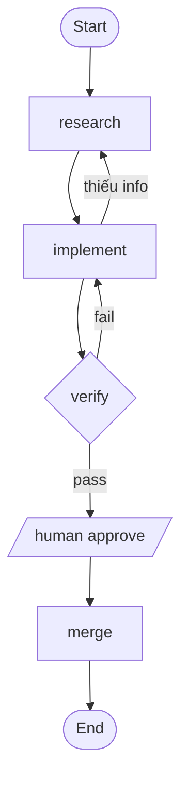
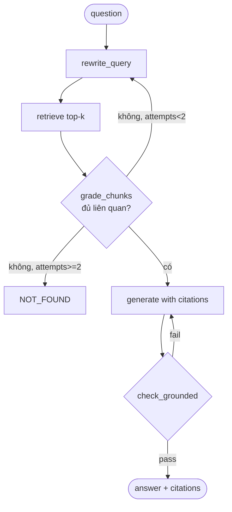

# Bài 14 – Từ loop đơn đến graph engineering

> Bài gốc: [EN](../docs/en/lectures/lecture-14-graph-engineering/index.md) · [VI](../docs/vi/lectures/lecture-14-graph-engineering/index.md)
> Code ví dụ: `.../lecture-14-graph-engineering/code/maker_checker_graph.py` (LangGraph, Python)
> Project thực hành: **P08: Draw your workflow as a graph** (`docs/en/projects/project-08-graph-engineering-first-graph/`, chỉ có docs)
> Milestone DocVault: **M13: `docs/graph.md` cho dev graph + agentic RAG graph chạy được**

---

## 1. Ý chính trong 30 giây

Khi task cần **chuyên môn hoá, song song, shared state, verify và recovery** thì nó không còn là một loop nữa mà đã thành một **graph**. Graph gồm 4 phần: **node, edge, shared state, routing rules**. Graph không phải phát minh mới. Nó là thứ loop trở thành khi đủ phức tạp. Điểm mới duy nhất là **node có thể là cả một agent** (có loop riêng), chứ không chỉ là một hàm.

## 2. Khái niệm cốt lõi

**Bốn tầng chồng lên nhau** (tầng sau không thay tầng trước):

| Tầng | Định hình | Câu hỏi |
|---|---|---|
| Prompt | Instruction | Nói model làm gì? |
| Context | Thông tin | Model cần biết gì? |
| Loop | Runtime | Lặp đến khi đạt goal thế nào? |
| Graph | Hệ thống | Nhiều agent/loop/tool/evaluator phối hợp ra sao? |

Harness (bài 01–12) là **nền móng** bên dưới cả bốn tầng.

**Bốn thành phần của graph:**

- **Node**: code deterministic, model call, tool, hoặc agent có loop riêng.
- **Edge**: tuần tự, song song (fan-out/fan-in), điều kiện, retry, rollback.
- **Shared state**: chỉ state được chia sẻ, **context của mỗi node là riêng**. Mỗi field phải khai báo cách merge (overwrite / append / sum).
- **Routing rules**: "test pass thì merge; fail thì về implement; thiếu thông tin thì về research".

**Loop và graph:** *"Loop là quyết định trì hoãn; graph là quyết định trước."* Loop giấu vấn đề bên trong nó, còn graph đưa vấn đề lên giấy.

**Ba lỗi cấu trúc của loop đơn ở quy mô lớn:**

1. **Goodhart**: metric tăng nhưng kết quả thật tệ đi (bot học cách đóng ticket).
2. **Mù hướng lên**: loop không bao giờ hỏi "goal này có đúng không?".
3. **Xung đột**: các loop độc lập kéo co lẫn nhau (tốc độ vs kỹ lưỡng).

**Anchors** buộc loop vào thực tế: dữ liệu ground truth, kết quả thật, human spot-check. Đây là phần hay bị bỏ qua nhất.

**Graph và workflow:** cùng khung xương. Workflow có node là hàm deterministic, edge hard-code (giống Temporal, Airflow, hay Durable Functions/Step Functions bạn đã biết). Graph là **tổng quát hoá**: node có thể là agent, edge có thể route động, và có thể chứa cả node của người (approval). Lời phản biện đáng giữ (iii.dev): **hình dạng graph không phải phần chịu lực**. Phần chịu lực là **replayability, observability, recoverability**.

**Orchestration tax:** khởi động agent thì rẻ, còn khép vòng (review, hoà giải) thì đắt. *"Bạn là GIL của các agent."* Thêm node không làm khả năng phán đoán của bạn chạy song song được.

**Năm tiêu chí để quyết định có cần graph** (cần ≥ 3): chia được thành unit độc lập; có branch/rollback; state trung gian đáng lưu; kết quả verify được; lợi ích phối hợp > chi phí phối hợp. "Nhiều bước" không có nghĩa là cần graph: pipeline 20 bước tuyến tính chỉ là một script.

## 3. Ví dụ minh hoạ: sáu bước dựng graph đầu tiên

1. **Shared state:** `{requirements, code, review: pass|fail, attempts (sum)}`
2. **Nodes:** research (agent), implement (agent có loop ≤3 lần), verify (agent, **context mới**, chỉ thấy `code`), merge (code deterministic).
3. **Edges:** research → implement → verify → merge.
4. **Routing:** verify pass thì merge, fail thì implement; implement thiếu thông tin thì research.
5. **Checkpoint:** lưu state sau mỗi bước; `pause_before("merge")` để chờ người duyệt.
6. **Run:** `run(graph, entry, thread="session-1")`.



## 4. Áp dụng vào DocVault: M13 (hai graph khác nhau)

Có hai graph cần phân biệt rõ: **graph phát triển** (cách agent build DocVault) và **graph sản phẩm** (cách DocVault trả lời câu hỏi). Graph thứ hai gắn thẳng với mục tiêu AI engineering của bạn.

### 4.1. Dev graph: `docs/graph.md`

Vẽ lại maker–checker loop của bài 13 thành graph:

| Node | Loại | Đọc | Ghi |
|---|---|---|---|
| pick | code | feature_list.json | `current_feature` |
| implement | agent (loop ≤3) | current_feature, docs/ | `diff`, `attempts` |
| verify_tests | code | diff | `tests: pass/fail` |
| verify_review | agent (context mới) | diff, rubric | `review: pass/fail, notes` |
| human | người | diff, notes | `approved` |
| merge | code | – | commit, chạy verify-feature.ts |

Fan-out: `verify_tests` và `verify_review` chạy **song song**, fan-in bằng rule "cả hai pass". Rollback: `verify_review` fail vì "sai kiến trúc" thì quay về **pick** (cần thiết kế lại), không phải về implement. Đây là một **edge vốn ẩn** trong loop, giờ mới được viết ra.

### 4.2. Product graph: Agentic RAG trong `QaService`

Nâng QaService từ pipeline tuyến tính thành graph (corrective/self-RAG):



Shared state: `{question, rewrittenQuery, chunks[], grades[], answer, citations[], attempts (sum)}`. Có thể dùng LangGraph.js:

```ts
import { StateGraph, Annotation, START, END, MemorySaver } from "@langchain/langgraph";

const QaState = Annotation.Root({
  question: Annotation<string>(),
  query: Annotation<string>(),
  chunks: Annotation<Chunk[]>({ reducer: (_, b) => b, default: () => [] }),
  answer: Annotation<string>(),
  citations: Annotation<Citation[]>({ reducer: (_, b) => b, default: () => [] }),
  attempts: Annotation<number>({ reducer: (a, b) => a + b, default: () => 0 }),
});

const graph = new StateGraph(QaState)
  .addNode("rewrite", rewriteQuery)
  .addNode("retrieve", retrieve)
  .addNode("grade", gradeChunks)
  .addNode("generate", generate)
  .addNode("check", checkGrounded)
  .addNode("notFound", async () => ({ answer: "NOT_FOUND", citations: [] }))
  .addEdge(START, "rewrite")
  .addEdge("rewrite", "retrieve")
  .addEdge("retrieve", "grade")
  .addConditionalEdges("grade", (s) => s.chunks.length > 0 ? "generate" : s.attempts >= 2 ? "notFound" : "rewrite")
  .addEdge("generate", "check")
  .addConditionalEdges("check", (s) => (s.citations.length > 0 ? END : "generate"))
  .addEdge("notFound", END)
  .compile({ checkpointer: new MemorySaver() });
```

(Code minh hoạ; `gradeChunks` cần tăng `attempts` khi không có chunk đạt; `check` cũng nên có giới hạn số lần retry.) Mỗi node là một span OpenTelemetry (bài 11). Anchor là `eval/questions.jsonl` (bài 13). So sánh `rag-eval` giữa pipeline tuyến tính và graph: nếu graph không thắng rõ ràng thì giữ pipeline. **Đừng vẽ graph chỉ để có graph.**

### 4.3. Chấm theo 5 tiêu chí

Với agentic RAG của DocVault: có rollback (rewrite), state đáng lưu (debug câu hỏi), verify được (eval set). Đạt ≥ 3 tiêu chí nên đáng làm graph. Với "import một file": tuyến tính, không rollback, nên chỉ cần một hàm.

## 5. Checklist tự kiểm tra

- [ ] `docs/graph.md` có mermaid + bảng node + routing rules + chỉ ra ≥1 edge vốn ẩn.
- [ ] Trả lời được 4 câu hỏi của eigent cho các loop trong DocVault: loop nào nuôi loop nào, ai sở hữu target, ai có quyền veto, metric nào được đổi và metric nào phải đóng băng.
- [ ] Agentic RAG chạy được, có so sánh eval với pipeline tuyến tính.
- [ ] Đã đọc `docs/en/lectures/lecture-14-graph-engineering/code/maker_checker_graph.py` và map được 6 bước.

## 6. Câu hỏi suy ngẫm

1. Metric bạn đang tối ưu gần đây có đang bị Goodhart không?
2. Ở hệ thống phân tán bạn từng làm (Kafka, SQS, saga), cái gì đã là "graph" từ trước khi có tên gọi này?
3. Bottleneck thật của bạn khi chạy nhiều agent là gì: compute hay review bandwidth?
