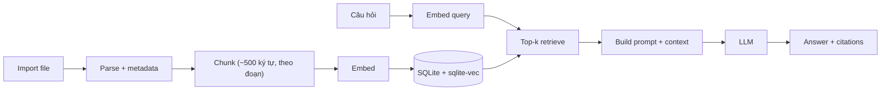

# Kế hoạch học Harness Engineering

> Bộ ghi chú tự học cho khoá **Learn Harness Engineering** (repo này), viết bằng tiếng Việt, giữ nguyên thuật ngữ kỹ thuật tiếng Anh.
> Mỗi bài có một file `.md` riêng gồm: khái niệm cốt lõi ở mức tổng quan, ví dụ minh hoạ, và phần **áp dụng vào app DocVault**, một app desktop quản lý kho tài liệu có hỏi đáp bằng AI (RAG) được build dần qua 14 bài.

---

## 1. Harness engineering là gì (trong một đoạn)

**Harness** là mọi thứ nằm ngoài model weights: instructions (`AGENTS.md`/`CLAUDE.md`), tools, environment, state (progress file, git), và feedback (test/lint/e2e). Khoá học lập luận rằng khi một coding agent (Claude Code, Codex...) thất bại, nguyên nhân thường không nằm ở model mà ở harness: task mơ hồ, quy ước không được ghi lại, môi trường không chạy được, không có lệnh verify, hoặc mất state giữa các session. Nhiệm vụ của harness engineer là **thiết kế môi trường để agent làm việc đáng tin cậy**, rồi ở bài 13–14 nâng lên thành **loop** (agent tự chạy lặp đến khi đạt goal) và **graph** (nhiều agent/loop phối hợp qua shared state).

Nếu so với kinh nghiệm backend: harness với agent giống như CI/CD + coding conventions + observability + runbook với một team dev. Khác biệt là "dev" này không hỏi ai được, mất trí nhớ sau mỗi session, và luôn tự tin quá mức.

---

## 2. Lộ trình 14 bài

Khoá có 14 lectures, đi kèm 8 projects thực hành. Các lectures chia thành 6 chặng:

| Chặng | Bài | Chủ đề | Project trong repo | Milestone DocVault |
|---|---|---|---|---|
| **A. Nền tảng** | [01](./01-strong-models-unreliable-execution.md) | Model mạnh ≠ thực thi đáng tin | P01 | M0: thí nghiệm baseline, viết Definition of Done |
| | [02](./02-what-a-harness-is.md) | 5 subsystem của harness | P01 | M1: app shell + harness tối thiểu |
| **B. Repo là nguồn sự thật** | [03](./03-repo-as-system-of-record.md) | Repository là system of record | P02 | M2: ARCHITECTURE/PRODUCT/ADR cho RAG |
| | [04](./04-split-instructions.md) | Tách instructions theo chủ đề | P02 | M3: AGENTS.md dạng router + topic docs |
| **C. Liên tục giữa các session** | [05](./05-context-across-sessions.md) | Giữ context qua nhiều session | P03 | M4: import + persistence qua 2 session |
| | [06](./06-initialization-phase.md) | Initialization là một phase riêng | P03 | M5: `init.sh`, example test, task breakdown |
| **D. Kiểm soát phạm vi** | [07](./07-task-boundaries-wip1.md) | Ranh giới task, WIP=1 | P04 | M6: chunking, mỗi lần một feature |
| | [08](./08-feature-lists-as-primitives.md) | Feature list là harness primitive | P04 | M7: `feature_list.json` + verifier cho embedding/vector store |
| **E. Verification thật sự** | [09](./09-premature-victory.md) | Chặn agent tuyên bố xong quá sớm | P05 | M8: grounded Q&A + 3 lớp termination check |
| | [10](./10-end-to-end-verification.md) | Chỉ E2E mới là verify thật | P05 | M9: Playwright E2E + architecture rules |
| **F. Vận hành bền vững** | [11](./11-observability.md) | Observability trong harness | P06 | M10: structured log + OpenTelemetry cho RAG pipeline |
| | [12](./12-clean-handoff.md) | Clean state cuối mỗi session | P06 | M11: exit checklist, quality doc, ablation |
| **G. Tự động hoá** | [13](./13-loop-engineering.md) | Loop engineering (`/goal`, `/loop`) | P07 | M12: RAG eval loop + maker-checker |
| | [14](./14-graph-engineering.md) | Graph engineering | P08 | M13: dev graph + agentic RAG graph |

Bài gốc: `docs/en/lectures/` (tiếng Anh) và `docs/vi/lectures/` (bản dịch tiếng Việt). Project: `docs/en/projects/` (mô tả) và `projects/project-NN/` (code `starter/` và `solution/`).

---

## 3. Lịch học đề xuất (khoảng 7 tuần, 6–8 giờ/tuần)

Mỗi bài theo nhịp **Đọc → Chạy code ví dụ → Áp dụng vào DocVault → Ghi lại bài học**.

| Tuần | Bài | Việc chính | Thời gian ước tính |
|---|---|---|---|
| 1 | 01, 02 | Đọc 2 bài, làm P01 (chạy agent 2 lần: prompt-only và có harness), dựng DocVault M0–M1 | 6–8h |
| 2 | 03, 04 | Làm P02, viết bộ docs cho DocVault, refactor AGENTS.md thành router | 6h |
| 3 | 05, 06 | Làm P03, thử "fresh session test", viết `init.sh` + progress/handoff | 6–8h |
| 4 | 07, 08 | Làm P04, chunking + embedding + vector store, mỗi feature một session | 8h |
| 5 | 09, 10 | Làm P05 (single-role so với gen-eval so với plan-gen-eval), grounded Q&A + E2E | 8h |
| 6 | 11, 12 | Làm P06 capstone, logging/tracing, cleanup loop, ablation | 8h |
| 7 | 13, 14 | Làm P07, P08: `/goal`, `/loop`, maker-checker, vẽ graph | 6–8h |

**Cách học mỗi bài (khoảng 60–90 phút đọc + phần còn lại là thực hành):**

1. Đọc file ghi chú tương ứng trong `study-notes/` để nắm khung.
2. Đọc bài gốc (`docs/vi/lectures/<bài>/index.md` hoặc bản tiếng Anh).
3. Chạy code ví dụ: `npx tsx docs/en/lectures/<lecture-dir>/code/<file>.ts`.
4. Làm project tương ứng trong `projects/project-NN/` (so sánh `starter/` với `solution/`).
5. Áp dụng phần "Áp dụng vào DocVault" của bài đó vào repo app riêng của bạn.
6. Ghi 3–5 dòng vào `docvault/docs/learning-log.md`: lỗi agent gặp, nó thuộc layer nào trong 5 layer, bạn đã sửa harness ra sao.

---

## 4. App xuyên suốt: DocVault

### 4.1. Mô tả sản phẩm

**DocVault** là app desktop chạy local để:

- Import tài liệu (`.md`, `.txt`, sau đó thêm `.pdf`, `.docx`) vào một kho cục bộ.
- Xem danh sách, chi tiết, xoá tài liệu; gắn tag/metadata.
- Index tài liệu: chunking → embedding → lưu vector.
- Hỏi đáp bằng AI theo kiểu RAG: retrieve các chunk liên quan → gửi cho LLM → trả lời **kèm citation** về đúng tài liệu/đoạn.
- Có quan sát được (log, trace), có eval set để đo chất lượng câu trả lời.

Đây chính là "knowledge-base app" mà khoá học dùng trong `projects/` (bản trong khoá dùng mock Q&A). DocVault là phiên bản của riêng bạn, đi xa hơn với RAG thật.

### 4.2. Stack đề xuất

| Lớp | Lựa chọn | Lý do |
|---|---|---|
| Desktop shell | **Electron 33 + TypeScript** | Giống hệt stack của `projects/` nên bạn có thể diff code của mình với `starter/`/`solution/` ở từng bài |
| UI | React 18 + Vite (+ Tailwind nếu muốn) | Bạn đã quen React/TS |
| Test | Vitest (unit/integration) + Playwright `_electron` (E2E) | Vitest có sẵn trong course; Playwright chạy được Electron |
| Lưu trữ | File JSON/text (giai đoạn đầu, giống course), sau đó **SQLite** (`better-sqlite3`) + **`sqlite-vec`** cho vector | Local-first, không cần server, một file DB duy nhất |
| Embedding | Bắt đầu bằng fake/hash embedding cho test; sau đó dùng API embedding (Voyage, OpenAI) hoặc local (`@huggingface/transformers`) | Tách bằng interface `EmbeddingProvider`, đổi provider không ảnh hưởng pipeline |
| LLM | Claude API (`@anthropic-ai/sdk`) qua interface `LlmProvider`; có `MockLlmProvider` cho test | Test deterministic, prod dùng model thật |
| Observability | Logger JSON có cấu trúc + **OpenTelemetry** (`@opentelemetry/sdk-node`) | Bạn đã quen OTel/Serilog/Dynatrace; trace từng bước RAG |
| Graph (bài 14) | LangGraph.js (`@langchain/langgraph`) hoặc tự viết state machine | Agentic RAG: retrieve → grade → rewrite → generate → check |

**Phương án thay thế cho dân .NET:** .NET 9 + **Avalonia UI** (MVVM, cross-platform) + EF Core/SQLite + Semantic Kernel hoặc Microsoft.Extensions.AI. Các nguyên tắc harness hoàn toàn giống nhau (`AGENTS.md`, `feature_list.json`, `init.sh`...). Chỉ có lệnh verify thay đổi (`dotnet build`, `dotnet test`). Trong mỗi bài có ghi chú ngắn cách làm tương đương trong .NET. Khuyến nghị: **học khoá bằng Electron/TS** để bám sát `projects/`, rồi port sang .NET sau nếu cần.

### 4.3. Kiến trúc mục tiêu (cuối khoá)

```
docvault/
├── AGENTS.md                 # router ~80 dòng (bài 04)
├── CLAUDE.md                 # trỏ về AGENTS.md + rule riêng cho Claude Code
├── init.sh                   # bài 06
├── feature_list.json         # bài 08
├── claude-progress.md        # bài 05
├── session-handoff.md        # bài 05/12
├── clean-state-checklist.md  # bài 12
├── quality-document.md       # bài 12
├── docs/
│   ├── PRODUCT.md  ARCHITECTURE.md  DECISIONS.md     # bài 03
│   ├── ipc-rules.md  rag-pipeline.md  testing.md      # bài 04
│   ├── sprint-contracts/  evaluator-rubric.md         # bài 11
│   └── graph.md                                       # bài 14
├── scripts/
│   ├── check-architecture.sh  verify-feature.ts       # bài 08/10
│   ├── cleanup-scanner.sh  rag-eval.ts                # bài 12/13
├── loops/  goal.md  loop-state.md                     # bài 13
├── src/
│   ├── main/        # Electron main: window, IPC handlers
│   ├── preload/     # contextBridge: window.api typed
│   ├── renderer/    # React UI
│   ├── services/    # DocumentService, IndexingService, RetrievalService, QaService
│   │   └── rag/     # chunker, embedder, vector-store, prompt-builder
│   └── shared/      # types.ts, IPC_CHANNELS
├── tests/  unit/  integration/  e2e/
└── eval/   questions.jsonl    # bộ câu hỏi + đáp án/citation kỳ vọng
```

Luồng RAG (đích đến):



---

## 5. Danh sách file ghi chú

1. [01 – Model mạnh không có nghĩa là thực thi đáng tin](./01-strong-models-unreliable-execution.md)
2. [02 – Harness thực sự là gì](./02-what-a-harness-is.md)
3. [03 – Repository là system of record](./03-repo-as-system-of-record.md)
4. [04 – Tách instructions ra nhiều file](./04-split-instructions.md)
5. [05 – Giữ context sống qua nhiều session](./05-context-across-sessions.md)
6. [06 – Initialization là một phase riêng](./06-initialization-phase.md)
7. [07 – Vẽ ranh giới task rõ ràng (WIP=1)](./07-task-boundaries-wip1.md)
8. [08 – Feature list là harness primitive](./08-feature-lists-as-primitives.md)
9. [09 – Ngăn agent tuyên bố chiến thắng quá sớm](./09-premature-victory.md)
10. [10 – Chỉ chạy full pipeline mới là verify thật](./10-end-to-end-verification.md)
11. [11 – Làm runtime của agent quan sát được](./11-observability.md)
12. [12 – Bàn giao sạch cuối mỗi session](./12-clean-handoff.md)
13. [13 – Từ prompt thủ công đến autonomous loop](./13-loop-engineering.md)
14. [14 – Từ loop đơn đến graph engineering](./14-graph-engineering.md)

---

## 6. Tiêu chí "học xong"

- [ ] Giải thích được 5 subsystem của harness và 5 layer chẩn đoán lỗi, kèm ví dụ thật từ DocVault.
- [ ] DocVault có đủ harness files; một agent session mới (không nói gì thêm) trả lời được 5 câu của "fresh session test".
- [ ] `./init.sh` chạy được từ máy sạch; `npm run check && npm test && npm run e2e` xanh.
- [ ] RAG trả lời có citation; có `eval/questions.jsonl` ≥ 20 câu và script đo groundedness.
- [ ] Có trace OpenTelemetry cho một câu hỏi: retrieve → generate, xem được latency từng bước.
- [ ] Đã chạy ít nhất một `/goal` và một `/loop` trên DocVault, có maker và checker tách riêng.
- [ ] Có `docs/graph.md` mô tả dev graph và agentic RAG graph, chỉ ra ít nhất một rollback edge.
